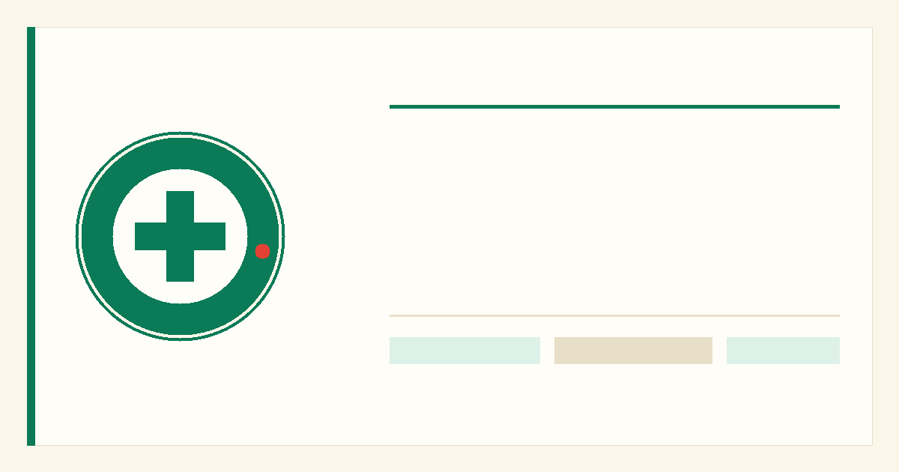
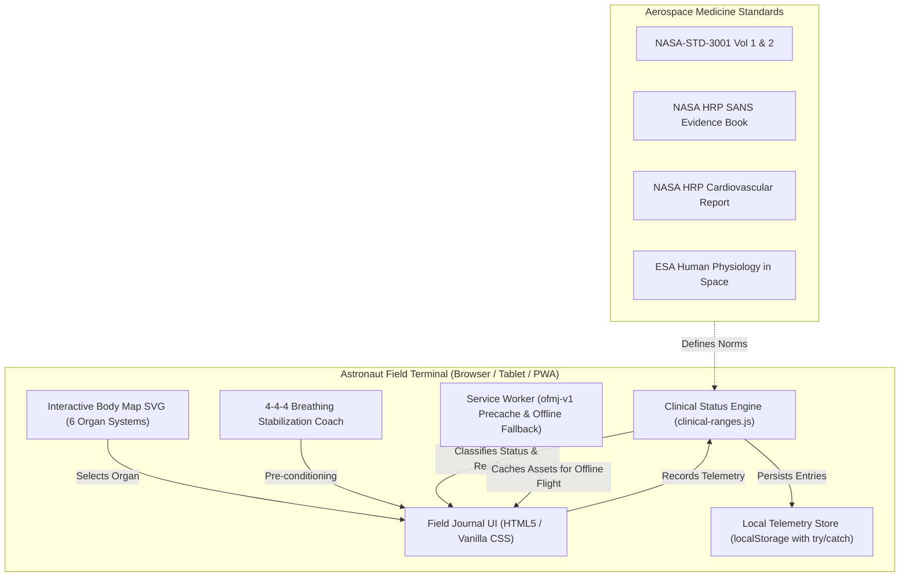

# Orbital Field Medical Journal

> **A warm, calm, editorial-clinical self-assessment and telemetry logging PWA designed for long-duration astronaut spaceflight missions.**

[](https://www.spaceappschallenge.org/)
[](#offline-pwa--service-worker)
[](#accessibility--space-ergonomics)
[](LICENSE)

---

## 🛰️ NASA Space Apps Challenge 2026

During long-duration human space exploration (such as Artemis lunar surface stays, Lunar Gateway expeditions, and Mars transit), communication latency with Earth ranges from 1.3 seconds to upwards of 24 minutes each way. Astronauts cannot rely on real-time telemedicine consultations during critical acute physiological shifts or routine daily countermeasure tracking.

**The Orbital Field Medical Journal** answers the **Astronaut Health Self-Assessment & Field Telemetry** challenge by providing a zero-dependency, offline-first Progressive Web App (PWA) tailored specifically for astronaut self-assessment, telemetry logging, and clinical triage under microgravity constraints.

- **Live Public URL (GitHub Pages):** [https://rohini-s-286.github.io/orbital-field-medical-journal/](https://rohini-s-286.github.io/orbital-field-medical-journal/)
- **Repository:** [https://github.com/Rohini-S-286/orbital-field-medical-journal](https://github.com/Rohini-S-286/orbital-field-medical-journal)

---

## 📸 Interface Previews



---

## ✨ Key Features

1. **Editorial-Clinical Field Journal Aesthetics:**
   - Soft Warm Ivory `#FBF6EA` paper surface with subtle micro-grain texture, replacing high-glare neon sci-fi dashboards to prevent eye strain during 6+ month orbital deployments.
   - Elegant typography pairing self-hosted `Fraunces` editorial serif with high-legibility `Inter` sans-serif and tabular numerals (`font-variant-numeric: tabular-nums`).
2. **Interactive Stroked Emerald Body Map:**
   - Vector SVG anatomical model stroked in thin emerald line-art (`#0B7A56`), with interactive touch targets for all 6 critical organ systems (Ocular SANS, Cardiovascular, Neurovestibular, Axial Spine, Pulmonary, and Lower Limb Countermeasures).
   - Tints and flags regions according to clinical thresholds.
3. **Multi-Signal Red-Green Colorblind Proof Status Scale:**
   - Colour is **never** the only signal. Every status conveys 4 simultaneous indicators:
     - **In range:** Emerald + Check-Circle icon + `"In range"` + solid border.
     - **Attention:** Ochre + Alert-Triangle icon + `"Watch"` + dashed border.
     - **Contact flight surgeon:** Vermillion + Telephone icon + `"Contact flight surgeon"` + 2px border.
     - **Emergency:** Solid Vermillion fill + Siren/Hazard icon + `"Emergency"` + 45° diagonal hatch pattern.
4. **Physiological Status Engine:**
   - Evaluates vitals (Systolic BP, Diastolic BP, Resting Heart Rate, SpO2) against peer-reviewed spaceflight reference envelopes (`clinical-ranges.js`) grounded in NASA-STD-3001 and NASA Human Research Program evidence books.
   - Detects and rejects impossible physiological values with inline accessible error alerts.
   - Calculates overall readiness score directly from evaluated organ telemetry (never increments score from merely recording data).
5. **Calm 4-4-4 Breathing Coach:**
   - An integrated 12-second rhythmic breathing guide (4s Inhale, 4s Hold, 4s Exhale) visually synchronizes with an expanding/contracting orb to normalize arterial pressure and stabilize venous return prior to recording vitals.
6. **Tiered Clinical Decision Guidance (Non-Pharmacologic):**
   - Standardized 4-tier decision support (Routine, Self-care, Contact flight surgeon, Emergency).
   - **Strict Safety Rule:** Strictly operational, environmental, and countermeasure procedures only (LBNP chibis protocol, head elevation, workstation ergonomic adjustment, ambient CO2 scrubbing checks); **zero drug dosing**.
7. **Complete Evidence & Sources Drawer:**
   - On-screen references linking all physiological thresholds to NASA and ESA flight standards. Full documentation in [EVIDENCE.md](EVIDENCE.md).
8. **Persistent Local Telemetry Log:**
   - Real-time client-side logging stored safely in `localStorage` (with comprehensive `try/catch` error guards) and rendered on-screen.

---

## 🏗️ System Architecture



---

## ♿ Accessibility & Space Ergonomics (WCAG 2.1 AA)

- **Gloved Operation:** All buttons, legend selector chips, dialog close targets, and stepper adjustment controls enforce a minimum touch target of **48 × 48px** with generous padding for intravehicular pressurized gloves.
- **Colorblind Redundancy:** Emerald, Ochre, and Vermillion are accompanied by distinct SVG iconography, explicit textual status labels, and unique border/hatch patterns. Trend charts use distinct line patterns (solid, dashed, dotted) and distinct markers (`●`, `◆`, `▲`).
- **Contrast Ratios (WCAG AA / AAA):**
  - Light theme body text (`#1F2A24` on `#FBF6EA`): **13.7:1** (AAA)
  - Muted notes (`#4B5A51` on `#FFFDF7`): **5.8:1** (AA)
  - Attention text token (`#855500` on `#FFFDF7`): **5.6:1** (AA)
  - Vermillion text token (`#B42318` on `#FFFDF7`): **5.5:1** (AA)
  - Dark theme body text (`#F4EEDD` on `#0F1A15`): **14.2:1** (AAA)
- **Modal Focus Management:** Closed drawers and dialogs are set to `visibility: hidden; pointer-events: none; opacity: 0;`, completely preventing focus leaks into hidden containers. Focus is restored to the triggering element upon closure.
- **Keyboard Navigation:** Native tab sequence, Enter/Space activation, high-contrast focus rings (`outline: 3px solid var(--color-emerald)`), and Esc key dismissal. Theme toggle `D` does not conflict with browser shortcuts (`Ctrl+D`).
- **Reduced Motion:** Full `prefers-reduced-motion: reduce` media query support disabling pulse rings, chart stroke drawing, and breathing scale transforms.

---

## 📦 Offline PWA & Service Worker

The application requires zero backend services and operates 100% offline via `sw.js`:
- **Cache Strategy:** Cache-first with network fallback.
- **Cache Name:** Versioned cache (`ofmj-v1`) with automatic pruning of obsolete caches on activation.
- **Pre-cached Assets:** HTML, CSS, JavaScript modules, Web Manifest, self-hosted WOFF2 fonts, and PNG icons.
- **Scope & URLs:** Strict relative paths (`./`) enabling hosting under both root domains and sub-paths (e.g. `/orbital-field-medical-journal/`).

---

## 💻 How to Run Locally

Because the project is built with zero dependencies, it runs out of the box with any local static HTTP server:

### Option A: Python (Standard Library)
```bash
# Clone the repository
git clone https://github.com/Rohini-S-286/orbital-field-medical-journal.git
cd orbital-field-medical-journal

# Run local HTTP server
python -m http.server 8080
```
Open **[http://localhost:8080/](http://localhost:8080/)** in your browser.

### Option B: Node.js / npx
```bash
npx serve .
```

---

## 🚀 Deployment Instructions

### 1. Primary Target: GitHub Pages (Automated via GitHub Actions)
The repository includes `.github/workflows/deploy.yml` which automatically builds and deploys on every push to `main`:
1. In your GitHub repository, navigate to **Settings** → **Pages**.
2. Under **Build and deployment** → **Source**, select **GitHub Actions**.
3. Pushes to `main` will automatically trigger `.github/workflows/deploy.yml` and publish to `https://rohini-s-286.github.io/orbital-field-medical-journal/`.

### 2. Backup Target: Netlify
The repository includes a production-ready `netlify.toml`:
1. Log in to [Netlify](https://app.netlify.com/).
2. Click **Add new site** → **Import an existing project** (or drag and drop the folder).
3. Connect your GitHub repository `orbital-field-medical-journal`.
4. Leave build command blank and publish directory as `.`. Click **Deploy site**.

---

## ⚠️ Limitations & Clinical Disclaimers

> **Decision-support research prototype, not a medical device.**
> - All readings, medical records, mission timelines, and patient scenarios in this application are **simulated** for interface demonstration and research training.
> - **No dosing advice:** The software strictly forbids and does not generate pharmaceutical or medication dosing advice.
> - **Clinician review required:** This tool provides operational decision support and must be evaluated by licensed aerospace medicine physicians (Flight Surgeons) prior to any human spaceflight implementation.

---

## 📄 License

This project is licensed under the [MIT License](LICENSE) © 2026 Rohini S.
